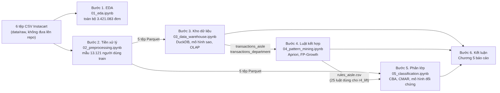

# Phân tích dữ liệu giao dịch và khai phá hành vi mua sắm trên bộ dữ liệu Instacart Market Basket

Đồ án cuối kỳ học phần **Khai phá dữ liệu nâng cao** (26D1ADV60900402), Trường Công nghệ và Thiết kế UEH.
Giảng viên hướng dẫn: TS. Đặng Ngọc Hoàng Thành. Thực hiện: Nhóm 04.

Kho mã này chứa toàn bộ mã nguồn, notebook, sơ đồ và bảng kết quả được dùng trong báo cáo. Mỗi notebook ứng với một bước của đề bài và một mục trong Chương 4 của báo cáo.

## Câu hỏi của đồ án

Những quy luật mua sắm rút ra từ dữ liệu giao dịch có giúp dự đoán sản phẩm được mua lại hay không? Để trả lời, nhóm đi qua sáu bước: phân tích thăm dò, tiền xử lý, xây dựng kho dữ liệu và OLAP, khai phá luật kết hợp, phân lớp dựa trên luật, và tổng hợp kết luận.

## Cấu trúc kho mã

| Thư mục hoặc tệp | Nội dung | Mục trong báo cáo |
|---|---|---|
| `notebooks/01_eda.ipynb` | Phân tích thăm dò trên toàn bộ dữ liệu | Chương 4, mục 2 |
| `notebooks/02_preprocessing.ipynb` | Lấy mẫu 13.121 người dùng train, làm sạch, xuất 5 tệp Parquet | Chương 4, mục 3 |
| `notebooks/03_data_warehouse.ipynb` | Kho dữ liệu DuckDB theo mô hình sao, mười phép kiểm tra chất lượng, roll-up, drill-down, slice, dice, ROLLUP, CUBE (câu lệnh SQL nằm trong notebook) | Chương 4, mục 4 |
| `notebooks/04_pattern_mining.ipynb` | Apriori, FP-Growth, tập đóng, luật kết hợp cấp gian hàng và ngành hàng | Chương 4, mục 5 |
| `notebooks/05_classification.ipynb` | CBA, CMAR, cây quyết định, LightGBM | Chương 4, mục 6 |
| `src/b5_classification/` | Mã nguồn CBA, CMAR, rời rạc hóa MDLP, đánh giá | Chương 3, mục 5 và 6 |
| `tests/` | Kiểm thử đơn vị cho bước 5 (`python -m pytest tests -q`) | |
| `diagrams/` | Sơ đồ quy trình và mô hình sao (tệp `.mmd` và `.png`) | Hình 3.1, Hình 3.2 |
| `outputs/step1/`, `outputs/step3/` | Số liệu tóm tắt EDA; bảng kiểm tra chất lượng và kết quả OLAP | Chương 4, mục 2 và 4 |
| `outputs/step4/` | Tập mục phổ biến, luật, bảng độ nhạy và hình của bước 4 | Bảng 4.23 đến 4.28 |
| `data/processed/b5/` | Nhãn, điểm cắt, luật CBA và CMAR, bảng kết quả trên tập kiểm tra | Bảng 4.29 đến 4.35 |
| `data/processed/rules_aisle.csv` | 26 luật gian hàng của bước 4, đầu vào thuộc tính r4_lift | Chương 3, mục 6.2 |
| `reports/figures/` | Hình của bước 5 | Hình 4.21 đến 4.23 |
| `docs/README_B5.md` | Định nghĩa nhãn, cách chia tập, điểm khác với bài báo gốc | |

## Dữ liệu

Dữ liệu gốc là The Instacart Online Grocery Shopping Dataset 2017, gồm sáu tệp `orders.csv`, `order_products__prior.csv`, `order_products__train.csv`, `products.csv`, `aisles.csv`, `departments.csv`. Nhóm tải bản trên Kaggle:

- https://www.kaggle.com/datasets/yasserh/instacart-online-grocery-basket-analysis-dataset
- Bản gốc của cuộc thi: https://www.kaggle.com/competitions/instacart-market-basket-analysis

Dữ liệu gốc (khoảng 700 MB) và năm tệp Parquet trung gian không được đưa lên kho mã. Xem cách đặt tệp tại [`data/README.md`](data/README.md).

## Cách chạy lại

Các notebook được viết cho Google Colab, dùng chung một thư mục gốc `REPO_DIR` (mặc định `MyDrive/Nhom04_ADM/repo`) và chạy lần lượt từ 01 đến 05.

| Thứ tự | Notebook | Đọc | Ghi |
|---|---|---|---|
| 1 | `01_eda.ipynb` | `data/raw/` | `reports/figures/eda/`, `outputs/step1/` |
| 2 | `02_preprocessing.ipynb` | `data/raw/` | 5 tệp Parquet trong `data/processed/` |
| 3 | `03_data_warehouse.ipynb` | 5 tệp Parquet | `data/processed/step3_transactions_for_association_mining.duckdb`, `outputs/step3/` |
| 4 | `04_pattern_mining.ipynb` | tệp DuckDB | `outputs/step4/`; tệp `T32_filtered_rules_aisle.csv` chép thành `data/processed/rules_aisle.csv` |
| 5 | `05_classification.ipynb` | 5 tệp Parquet, `rules_aisle.csv` | `data/processed/b5/`, `reports/figures/` |

Mỗi notebook 01, 02, 03 kết thúc bằng một ô đối chiếu các con số chính với báo cáo. Notebook 02 không ghi đè tệp Parquet đã có mà ghi bản mới vào `data/processed/_kiem_tra_buoc2/` rồi so từng tệp.

Cài thư viện: `pip install -r requirements.txt`. Mọi bước lấy mẫu và chia tập dùng hạt giống 42. Thời gian chạy của Apriori và FP-Growth thay đổi theo máy, các con số còn lại phải khớp báo cáo.

## Kết quả chính

| Bước | Kết quả |
|---|---|
| Kho dữ liệu | Bảng sự kiện 2.205.019 dòng, 10 phép kiểm tra chất lượng đều 0 vi phạm; produce và dairy eggs chiếm 46,12% số dòng sản phẩm prior |
| Luật kết hợp | 10.000 đơn, minsup 10%: 36 tập phổ biến cấp gian hàng, 93 cấp ngành hàng; 26 và 112 luật sau lọc; luật mạnh nhất fresh fruits + fresh vegetables → packaged vegetables fruits, lift 1,621 |
| Phân lớp | 848.233 cặp người dùng và sản phẩm, nhãn 1 chiếm 9,74%; trên 2.624 người dùng kiểm tra: CBA cân bằng F1 0,400 [0,390; 0,411], PR-AUC 0,354; LightGBM F1 0,431; thuộc tính r4_lift không cải thiện dự đoán |

## Thành viên

| Thành viên | Phụ trách |
|---|---|
| Cao Tấn Hùng (nhóm trưởng) | Bước 5: phân lớp CBA, CMAR |
| Đoàn Thị Thanh Tân | Chương 1, Chương 5, hợp nhất báo cáo |
| Lê Thị Thanh Thư | Bước 1: phân tích thăm dò |
| Đinh Quỳnh Trang | Bước 4: tập phổ biến và luật kết hợp |
| Trần Thiên Trang | Bước 2: tiền xử lý dữ liệu |
| Dương Thảo Vy | Bước 3: kho dữ liệu, OLAP và Data Cube |

## Ghi chú

Kho mã phục vụ mục đích học tập. Dữ liệu Instacart thuộc quyền của Instacart và được dùng theo điều khoản của nguồn phát hành.
